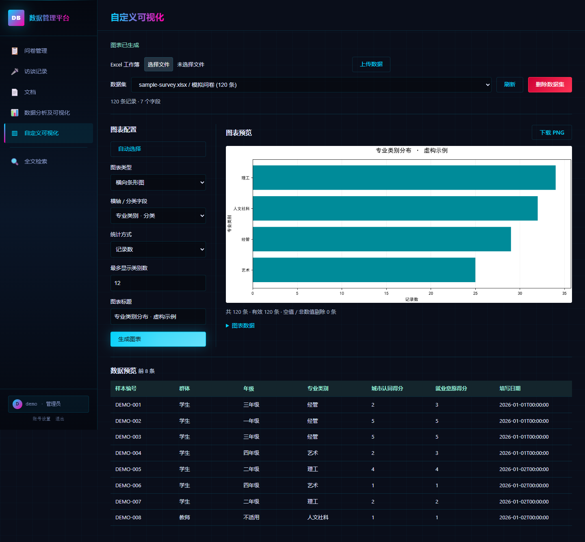
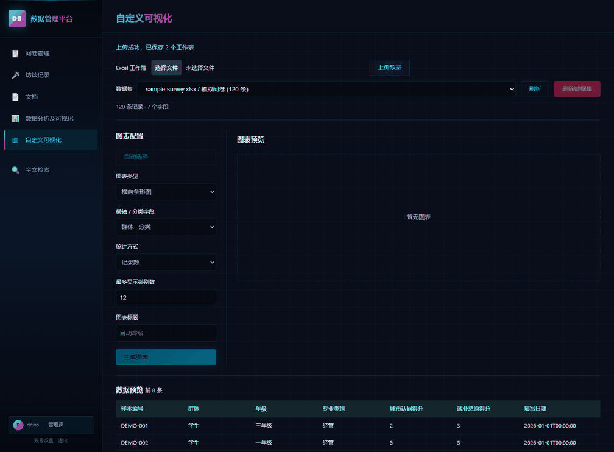
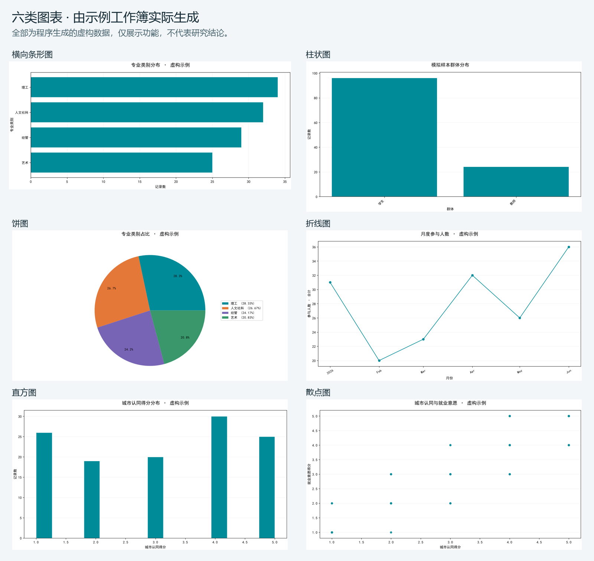

# Research Data Platform · 研究资料管理与可视化

[](https://github.com/yunsong421/research-data-platform/actions/workflows/ci.yml)


统一管理问卷、文档及访谈音视频；上传 Excel，自选数据与字段，生成六类可视化图表。面向小型研究项目，支持本地部署和数据本地存储。

**不包含真实研究数据、账号或数据库。** 首次启动为空库；截图和 [示例工作簿](examples/sample-survey.xlsx) 全部使用程序生成的虚构数据。

[快速启动](#快速启动) · [模拟数据试用](#用模拟数据生成第一张图) · [功能与技术](#技术与功能) · [详细配置](#配置) · [使用边界](SECURITY.md)



## 看看效果

从选数据、选字段到生成图表，以下演示均在本地实际运行页面中录制：





## 快速启动

需要先安装 [Python 3.11](https://www.python.org/downloads/)，Windows 安装时勾选 **Add python.exe to PATH**。下载并解压本仓库后：

| 系统 | 启动方式 |
| --- | --- |
| Windows | 双击 `start.bat` |
| macOS / Linux | 在项目目录执行 `sh start.sh` |

启动脚本会建立 `.venv`、安装依赖、引导创建首个管理员，并在服务就绪后打开浏览器。首次运行需联网；后续仅在依赖清单变化时重新安装。默认使用 5000 端口，被占用时在接下来的 20 个端口中选择。保留终端窗口，按 `Ctrl+C` 停止服务。服务器环境可执行 `python launch.py --no-browser`。

首次创建账号时，输入自己选择的用户名和至少 12 位密码，再确认一次。密码输入不回显是正常的；**没有默认用户名或密码**。Linux 可能需先安装 `python3-venv`，中文图表需系统中文字体，例如 Debian / Ubuntu 的 `fonts-noto-cjk`。启动异常可使用下文[手动启动](#手动启动)。

## 用模拟数据生成第一张图

1. 登录后打开“自定义可视化”。
2. 上传仓库内的 [`examples/sample-survey.xlsx`](examples/sample-survey.xlsx)，选择“模拟问卷”。
3. 点击“自动选择”，或选择“横向条形图”，将分类字段设为“专业类别”、统计方式设为“记录数”。
4. 点击“生成图表”，查看数据统计并下载 PNG。

示例包含 120 条虚构问卷和 6 条月度汇总，六种图表的字段搭配见 [示例说明](examples/README.md)。自动选择按字段类型推荐配置，可随时调整，不代表显著性检验或因果分析。

## 技术与功能

- Python 3.11、Flask、SQLAlchemy、SQLite FTS5。
- Jinja2、原生 JavaScript、CSS；pandas、openpyxl、matplotlib、Pillow。
- 问卷记录管理、数据预览、题目列表和源文件下载。
- 文档及访谈的上传、分类、查询、编辑、删除和下载，支持学生与教师分类。
- 支持格式的在线文档预览、视频播放、批量文件上传及关键词搜索。
- 用户登录、密码修改与管理员账号管理。
- 针对既有问卷结构的12类图表，包括样本分布、留青意愿及各校交叉分布。
- 自定义可视化：上传自己的 Excel，选择数据集、字段、统计方式及六种图表，自动推荐配置并下载 PNG。

原有“数据分析及可视化”依赖特定中文表头和文本选项；新增“自定义可视化”支持其他表头的 Excel。独立标签管理页和仪表盘入口已移除，部分历史模板与接口仍保留。不将描述性图表视为显著性检验或因果分析。

## 自定义图表

登录后进入“自定义可视化”，上传 `.xlsx`，或从数据集下拉框选择数据库中已有的 Excel 工作表。第一行应为表头，每行一条记录；多工作表会分别成为数据集。上传文件最多 10 MB、20 个工作表、10000 条非空数据，每表最多 100 列。

“自动选择”按字段类型填入推荐配置；也可自行选择横向条形图、柱状图、饼图、折线图、直方图、散点图。分类统计支持记录数、合计和平均值，直方图支持设置分箱数，散点图使用两个数值字段。数字编码的分类变量仍可选择柱状图计数，编码含义由使用者核实。

点击“生成图表”预览并下载 PNG。页面显示数据预览、有效记录数、剔除记录数和未显示类别数。计数仅排除分类空值；合计/平均值还排除无效数值。类别默认按统计值降序，折线图按日期或数值升序；显示上限不改变每个类别的统计值。饼图不接受负值、零合计或截断类别，避免百分比失真。直方图和散点图使用全部有效记录。数据按单元格原值处理，不自动拆分多选题、不自动反向计分，不进行显著性或因果推断。

自定义上传只新增 `chart_datasets` 表中的数据，不覆盖问卷、文档、访谈及原有分析源；删除仅针对这里上传的数据集。数据保存在当前部署的本地 SQLite 中，不上传 GitHub 或第三方服务。与原平台一致，登录用户共享该部署的数据。首次升级会自动创建新增表，无需修改已有表。

## 手动启动

请在本仓库目录执行，建议使用 Python 3.11。

Windows PowerShell：

```powershell
python -m venv .venv
.\.venv\Scripts\python.exe -m pip install -r requirements.txt
.\.venv\Scripts\python.exe init_admin.py
.\.venv\Scripts\python.exe wsgi.py
```

Linux / macOS：

```bash
python3 -m venv .venv
.venv/bin/python -m pip install -r requirements.txt
.venv/bin/python init_admin.py
.venv/bin/python wsgi.py
```

访问 <http://127.0.0.1:5000>，使用刚创建的账号登录。没有默认密码。Linux 中文图表需中文字体，例如 Debian/Ubuntu 的 `fonts-noto-cjk`。

运行时自动创建 `data/` 保存数据库和随机会话密钥，此目录被 Git 排除。

### 下载者的账号

公开 GitHub 仓库的代码下载不需要本网站账号。下载后运行网站则需要登录：每个部署者先运行 `python init_admin.py`，自行填写管理员用户名，并设置至少 12 位密码，再输入一次确认。终端输入密码时不显示字符属于正常现象。首次安装没有默认账号或密码，不附带作者的账号、演示账号或研究数据。管理员可在“账号设置”中为同一部署的其他使用者创建账号。账号与数据均保存在部署者自己的 `DATA_DIR` 下。

这不是双击 HTML 即可使用的静态网站，需要 Python 后端持续运行。GitHub 用于分发源码，GitHub Pages 无法运行 Flask 和 SQLite 后端。请在本机或支持 Python/Docker 的服务器运行。

各管理页的“导出”生成 Excel 元数据表，不包含文件及视频二进制附件；附件使用单项下载，完整备份请参阅 `docs/DATA.md`。

## Docker

```bash
docker compose build
docker compose run --rm data-platform python init_admin.py
docker compose up -d
```

访问同一本机地址。`data/` 持久化挂载到容器，构建仅复制白名单代码。宿主机端口默认只绑定回环地址。

## 项目结构

```text
app.py                  页面和 API
visualizations.py       自定义数据集、统计与图表 API
models.py               模型、全文检索、空库建表
config.py               数据目录与会话密钥
init_admin.py           首次管理员创建
launch.py               环境准备、账号引导、端口选择
start.bat / start.sh    Windows 与 macOS / Linux 启动入口
wsgi.py                 Waitress 服务入口
templates/              页面模板
static/                 CSS 和 JavaScript
deploy/                 Nginx、systemd 示例
docs/                   数据及发布说明
examples/               虚构问卷、生成脚本与字段搭配示例
tests/                  空库与数据隔离测试
.github/workflows/      持续集成
```

## 配置

| 环境变量 | 默认值 | 用途 |
| --- | --- | --- |
| `DATA_DIR` | 本仓库的 `data/` | 数据库与密钥目录 |
| `APP_HOST` | `127.0.0.1` | 监听地址 |
| `APP_PORT` | `5000` | 监听端口 |
| `APP_SECRET_KEY` | 随机生成并保存在数据目录 | 会话签名密钥 |

`.env.example` 是配置示意，Python 不会自动读取 `.env`。PowerShell 用 `$env:变量名='值'`，Linux 用 `export 变量名=值`。数据目录建议设置为绝对路径。

## 验证与发布

```bash
python -m unittest discover -s tests -v
```

测试使用临时空库和虚构账号，不读取私人资料。请参阅[发布说明](docs/PUBLISHING.md)、[数据说明](docs/DATA.md)和[安全说明](SECURITY.md)。只以本目录作为仓库根目录，不要在存有私人研究资料的上级目录执行 `git add .`。

本项目未附开源许可证；代码发布授权方式由版权持有人决定。公开代码不代表公开研究资料。

## 反馈与贡献

遇到问题可在 [Issues](https://github.com/yunsong421/research-data-platform/issues) 中提供操作步骤、预期结果、系统及 Python 版本，或使用虚构数据复现。不要提交真实受访者资料、数据库或凭据。功能建议、文档纠错及可复现的测试案例都很有帮助。

如果项目能帮助你管理研究资料或生成图表，欢迎 Star 收藏。版本说明见 [v1.0.0 发布草稿](docs/RELEASE-v1.0.0.md)。
